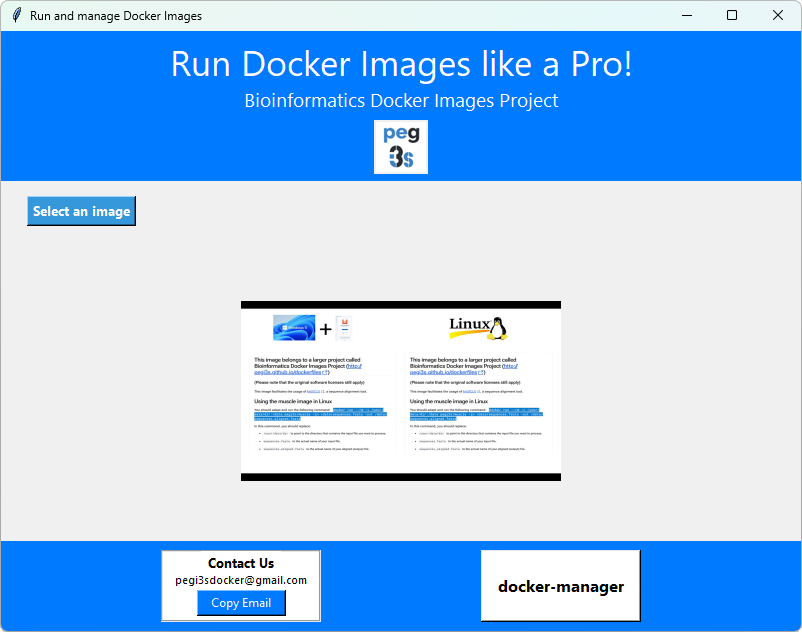
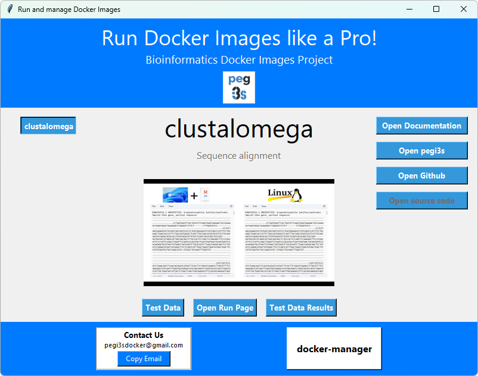
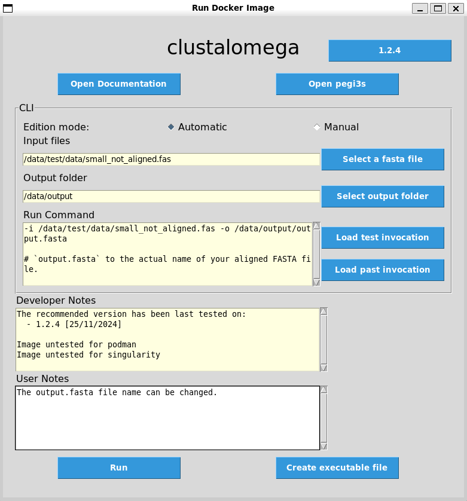
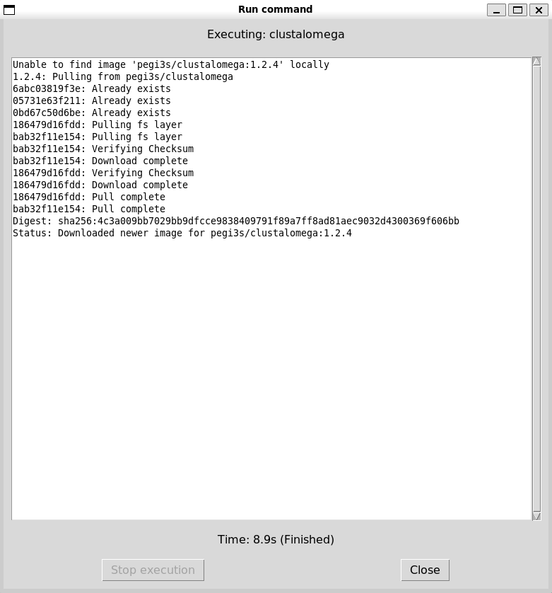

# Run commands using a GUI

**docknrun** is a Docker image that provides a graphical user interface (GUI) to facilitate:

- **Choosing images** via the **Select an Image** button (Figures 1 and 2).
- **Managing images** via the **docker-manager** button, which launches an instance of the `docker-manager` Docker image (Figure 1).
- **Running Docker images** (Figure 3).

In the main window, the **pegi3s** button also provides quick access to the project website ([http://bdip.i3s.up.pt/](http://bdip.i3s.up.pt/)) alongside informative videos.

## Main Window

The **Select an Image** button lets you choose the desired Docker image using the same ontology information implemented at [http://bdip.i3s.up.pt/](http://bdip.i3s.up.pt/). Once an image is selected, buttons become available to:

- **Open documentation** for the selected software (**Open documentation** button).
- **Access pegi3s information** at [http://bdip.i3s.up.pt/](http://bdip.i3s.up.pt/) for the selected Docker image (**Open pegi3s** button).
- **Open the GitHub page** (**Open GitHub** button).
- **Open the source code page** (**Open source code** button).
- **Access Test Data** for the selected image (**Test Data** button; test data is available for most Docker images and will soon be available for all of them).
- **Access Test Data Results** (**Test Data Results** button).

Selecting the **Open Run Page** button opens a new window (Figure 3) where you can configure and run the desired software.

<!-- ::start:figure-pair -->

\
*Figure 1. docknrun main window.*

\
*Figure 2. docknrun main window showing the selection of the Docker image "clustalomega".*

<!-- ::end:figure-pair -->

## Run Docker Image Window

In the docknrun **Run Docker Image** window, you can:

- Check the documentation for the selected image.
- Choose the image version (e.g., `clustalomega:1.2.4` in Figure 3; the Docker image version usually matches the software version).
- Select the **input data** (e.g., the **Select a fasta file** button in Figure 3).
- Specify the **output folder** (**Push** button; the folder will be created if it does not exist).
- View **Developer Notes** (e.g., bug reports, Singularity/Podman compatibility, last testing date).
- Add **User Notes** (comments for future reference stored in the `documentation_folder` directory inside the working directory).

> [!IMPORTANT]
> **Working Directory Notes:** If you want to change the working directory, copy the `documentation_folder` folder to the new location. Otherwise, your user history (comments, saved executables, and latest invocation files) will be lost.

### Additional Features

- **Create executable file**: Generates executable files.
- **Latest invocation**: Loads the latest invocations of the selected image.
- **Test Data Invocation**: Adapts the command in the **Run command** box to use test data (test data must be downloaded first).

Selecting the **Run** button opens a new window displaying the active operations and the elapsed time for the analysis (Figure 4). If the selected image is already pulled locally, the "running" box may remain empty.

<!-- ::start:figure-pair -->

\
*Figure 3. docknrun "Run Docker Image" window.*

\
*Figure 4. docknrun "Run Docker Image" secondary window.*

<!-- ::end:figure-pair -->

## Running the docknrun Docker Image

To run this Docker image, create a file named `config` in your working directory that declares the location of the files to be processed:

```bash
dir="/your/data/dir"
documentation_folder=documentation_folder
```

Then, adapt and run the following command (you may need to run `xhost +` first):

```bash
docker run --rm -ti \
  -e USERID=$UID \
  -e USER=$USER \
  -e DISPLAY=$DISPLAY \
  -v /var/db:/var/db:Z \
  -v /tmp/.X11-unix:/tmp/.X11-unix \
  -v $HOME/.Xauthority:/home/developer/.Xauthority \
  -v /var/run/docker.sock:/var/run/docker.sock \
  -v /tmp:/tmp \
  -v /your/data/dir:/data \
  pegi3s/docknrun
```

Where `/your/data/dir` points to the directory containing the `config` file.
